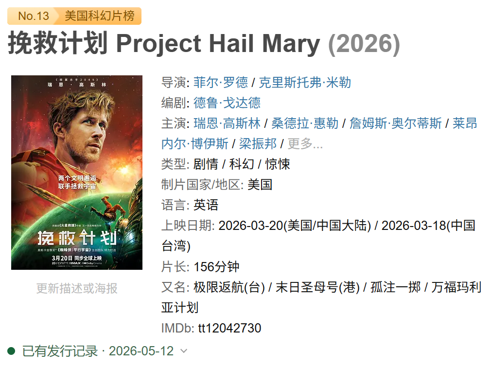
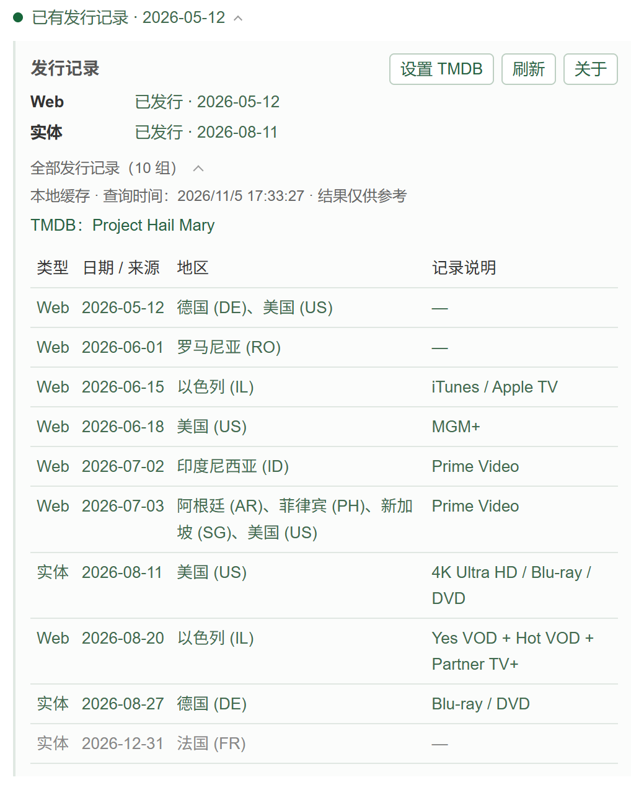

# 发行信号 / Release Signal

## 简介

在豆瓣影视详情页显示电影的 **Web／实体发行记录**，以及剧集的**按季播出进度**，帮助你在寻找片源前多一点参考。

平时只有一个颜色圆点和一行状态；电影有发行记录时，会附上最早的对应日期。点击后显示 Web／实体摘要；剧集显示最近一集和下一集。再展开一层可查看完整记录与来源。

默认收起，只占一行：

点击展开，再打开“全部发行记录”：

| 状态 | 含义 |
| --- | --- |
| 已有发行记录 | 至少有一条记录的日期已到 |
| 等待发行 | 目前只查到未来日期 |
| 暂未查到发行记录 | 没有查到可用记录，无法确认 |

剧集会显示“预计开播”“已有播出记录”或“本季完结”。无法自动确认季数时，可在展开区选择；只有第一季时会自动选择。切换其他季仅供临时查看，重新加载页面后按当前豆瓣条目重新判断。

**发行记录不保证已有片源；暂未查到不等于没有片源。**

## 安装

可使用 **暴力猴（Violentmonkey）** 或 **篡改猴（Tampermonkey）**，两者均已有电影与剧集实机验证。篡改猴的沙盒设置保持“默认”即可。

1. 从[暴力猴官网](https://violentmonkey.github.io/get-it/)或[篡改猴官网](https://www.tampermonkey.net/)安装适合你浏览器的扩展。
2. 点击[安装发行信号](https://raw.githubusercontent.com/chenfangshuo/Release-Signal/main/release-signal.user.js)，在脚本管理器页面中确认安装。若浏览器提示需要允许用户脚本，按扩展指引开启。
3. 若链接无法打开，或只显示代码，可从 [Releases](https://github.com/chenfangshuo/Release-Signal/releases) 下载 `release-signal.user.js`，用文本编辑器打开并复制完整代码；在脚本管理器中“新建脚本”，替换全部内容并保存。
4. 注册或登录 TMDB，打开 [API 设置](https://www.themoviedb.org/settings/api)，按页面指引申请 API 使用权限，复制 **API Read Access Token**。
5. 打开一个[豆瓣电影详情页](https://movie.douban.com/subject/1292052/)，点击发行状态行 →“设置 TMDB”，保留默认的 Token 类型，点击“设置并查询”，在弹出的浏览器输入框中粘贴 Token。验证成功后就会自动查询。

已有 **API key（v3）** 的用户，也可以在设置中切换类型后填写。两种凭据选一种即可。

更新时可在脚本管理器中检查脚本更新，也可重新点击安装链接。手动复制代码安装的旧版，可编辑原脚本、替换完整代码并保存。更新后刷新豆瓣页面；原有凭据和已保存的 API 地址会保留。

## 注意事项

- **支持范围。** 仅支持电脑端豆瓣影视详情页；剧集按季显示播出进度。IMDb 编号指向单集时，会尝试定位所属剧集与季；缺少编号或所属信息时无法可靠查询，季数存在冲突时需要手动确认。
- **日期仅供参考。** 数据来自 TMDB，可能缺失、有误或发生延期。“已发行”只表示记录中的日期已到，未核实实际上线；Web 对应数字发行，实体记录也不代表一定有蓝光版本。
- **完结需要明确依据。** 只有 TMDB 标注季终集、当季集数完整且所有集的日期都已到时，才显示绿色“本季完结”。这仍是来源记录判断，未独立核实实际播出；没有下一集日期不代表完结，播出进度也不代表平台已上线。
- **保管好自己的凭据。** 凭据保存在脚本管理器中，仅用于请求 TMDB；原生输入框通常明文显示，请勿截图或分享其中内容。更换时点击设置中的“替换凭据”，也可删除。
- **网络连接。** 默认使用 `api.tmdb.org`，已有国内网络直连测试通过。连接不上时，可在设置中切换为 `api.themoviedb.org（备用）`，点击“保存并查询”，无需重新输入凭据。两种地址均使用 HTTPS，能否连接取决于你的网络。
- **信息会缓存。** 想重新查询时点击“刷新”。遇到认证失败请检查凭据；查询失败不能当作没有发行记录。
- **遇到运行问题。** 先更新脚本和管理器，再重新加载豆瓣页面；仍异常时，反馈“关于”里的管理器版本和运行模式即可，不要发送密钥。无需更改全局沙盒设置。

数据来自 [TMDB](https://www.themoviedb.org)，本工具未获 TMDB 背书或认证。

> This product uses the TMDB API but is not endorsed or certified by TMDB.

源码采用 [MIT 许可证](LICENSE)。开发、测试与兼容性记录见 [DEVELOPER.md](DEVELOPER.md)。
